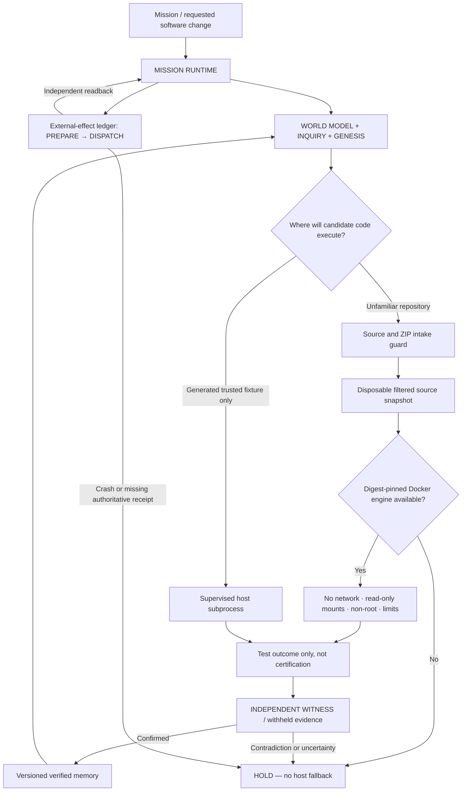

<p align="center"></p>

<h1 align="center">NOMAD</h1>
<p align="center"><strong>Learn what code does. Remember what happened. Protect the system that learns.</strong></p>
<p align="center"><em>v0.17.0 · SECURITY & RECOVERY · Evidence-first protected execution research</em></p>

<p align="center">
  
  
  
  
  
</p>

> **NOMAD is an experimental Bitwork-derived self-coding architecture.** It learns bounded repair strategies from execution feedback, builds code transformations, retains evidence, and runs restartable coding missions. **v0.17 protects the boundary around those capabilities.** It does not claim that a Python subprocess is a sandbox, a checksum is an authenticated signature, or passing tests means a patch is production-safe.

**North star:** *mission → perception → diagnosis → code transformation → isolated execution → independent WITNESS → evidence memory → improvement*. No cloud LLM or remote account is needed for the trusted-fixture research engine.

## Security-first architecture



The Docker branch is **implemented but not natively validated in this environment**; Docker is absent, so unfamiliar execution immediately returns HOLD. `--trusted-fixture` remains for generated CodeWorld tests only and must never be used for downloaded source.

## What changed in v0.17

| Protection | Concrete mechanism | Test/limitation |
|---|---|---|
| **Untrusted execution default deny** | `nomad/isolation.py` has exactly one unfamiliar-code backend: digest-pinned Docker. No Docker → refuse. | Verified fail-closed path; no Docker host here to validate actual kernel containment |
| **Source admission** | Reject symlinks, hardlinks, special files, credential-like paths, `.git`, oversized files and path-depth abuse; copy to a disposable source-only snapshot. | Adversarial and normal snapshot tests passed |
| **ZIP admission** | ZIP path normalization, traversal/symlink detection, CRC checks, size/ratio quotas and no overwrite. | Malicious ZIP fixtures rejected |
| **Process supervision** | Child argument vectors, minimal environment, timeouts, bounded output, POSIX process-group termination. | Local POSIX tests passed; Windows `taskkill` is best effort only |
| **Mission recovery guard** | A mission whose external ledger is missing or has an unresolved effect refuses to resume. | Tested without modifying the protected original source |
| **External action fencing** | `PREPARED`, fsynced `DISPATCHED`, durable owner epochs, explicit independent readback, permanent effect IDs. | Real process-death simulation holds on unknown dispatch |
| **Verification authority** | Docker test success is not WITNESS admission; unresolved container cleanup HOLDs. | API/driver contract tested; remote witness trust boundary is not yet authenticated |
| **Historical provenance** | Previous v0.16 archive and original BGR runtime retained byte-for-byte, with reproducible manifest checks. | New verifier checks original bytes; no historical claims are rewritten |

### Explicit promise: fail closed

NOMAD cannot automatically respond to an unavailable Docker engine by running repository code under the user's Windows or Linux account. The same rule applies when Docker cannot confirm disposal of a test container or when an external operation has an uncertain outcome. Those outcomes are **HOLD**, not success.

A Docker container is not the same as a dedicated virtual machine, and these command flags have not yet been challenged against a live Docker daemon. **Do not run hostile or unknown source on your primary workstation until the [native qualification matrix](docs/SECURITY_THREAT_MODEL.md) is completed.**

## Run the protected controls

### 1. Verify environment without executing unknown code

```powershell
py -3 -m nomad.protect_cli doctor
py -3 -m unittest tests.test_security_v17 -v
py -3 scripts\verify_package_v17.py --security
```

The current environment responds `docker_binary_present=false`, `ready_for_untrusted_code=false`. The doctor command intentionally does not certify kernel isolation just because the CLI exists.

### 2. Check incoming source archives

```powershell
py -3 -m nomad.protect_cli extract --archive .\incoming.zip --destination .\runs\incoming-inspected
```

This extracts only bounded source entries and **does not execute code**. Do not mix evidence or credentials into the disposable project directory.

### 3. Unfamiliar source: explicit trusted Docker image required

A reviewed, pre-pulled image must be supplied by its full content digest. Do not use `latest` or an invented digest.

```powershell
# Replace the placeholder with the digest of an image you have independently reviewed.
$img = 'registry.example/nomad-python@sha256:<64-hex-content-digest>'
py -3 -m nomad.protect_cli sandbox --source .\incoming-inspected --image $img --kind python-unittest --timeout 20
```

The container attempts the repository's `unittest` discovery with a **read-only snapshot and no network**. A successful test exit code **does not authorize merge, deployment, skill promotion or a production claim**. The image and resource policy may need a platform-specific preflight; this release does not automatically fetch dependencies from the internet.

### 4. Continue the trusted research mission

```powershell
py -3 -m nomad.mission_cli init --root runs\trusted-mission --family bin --seed 9117
py -3 -m nomad.mission_cli run --root runs\trusted-mission --trusted-fixture
py -3 -m nomad.mission_cli status --root runs\trusted-mission
```

This retains the original v0.16 on-disk fixture mission contract, now using reduced inherited environment and supervised process groups. It also refuses to run if its external-effect ledger is unresolved or missing. **No OS sandbox surrounds the trusted fixture path.**

### 5. Inspect external-effect recovery

```powershell
py -3 -m nomad.protect_cli effects-status --root runs\trusted-mission\effects
```

A caller that wishes to issue a non-idempotent remote action must use the `EffectLedger` API and supply a genuinely independent reconciliation callback. The included system **does not automatically perform payments, GitHub pushes, deployments, or other irreversible external actions**.

## Evidence and release gates

The original **v0.16 study** established six paired interruption recoveries in trusted generated Python fixtures. v0.17 preserves that archived record unchanged.

The v0.17 security evaluation comprises adversarial source-intake tests, local process supervision, hard-crash effect recovery, stale owner/receipt checks, mocked container command/cleanup verification and inherited regressions. See the [v0.17 experiment](docs/EXPERIMENT_V017.md) and [security threat model](docs/SECURITY_THREAT_MODEL.md).

**What still holds:** Actual Docker isolation and Windows process/FS acceptance, authenticated remote WITNESS, irreversible external actions, general self-coding autonomy and proof that native BGR improves external coding success. v0.14 external transfer was negative, and v0.15 restored only cold-search parity; the v0.17 hardening work does not change those facts.

## Repository guide

| Path | Purpose |
|---|---|
| `nomad/isolation.py` | Disposable source snapshot; resource-scoped Docker-only unfamiliar-code execution |
| `nomad/supervised.py` | Bounded *trusted* subprocess supervision, minimal environment, process-group cleanup |
| `nomad/archive_guard.py` | ZIP traversal and archive-explosion defense |
| `nomad/effects.py` | Fenced external-effect journal and independent-readback reconciliation |
| `nomad/protect_cli.py` | Doctor, sandbox, checked extraction, effect status commands |
| `nomad/mission_runtime.py` | Preserved durable mission controller, with external ledger preflight and supervised runner |
| `tests/test_security_v17.py` | 19 targeted threat-model tests, including real hard-crash recovery |
| `docs/SECURITY_THREAT_MODEL.md` | Attack matrix, trust boundaries, mandatory Windows/container qualification |
| `docs/EXPERIMENT_V017.md` | Tests, negative controls, deployment holds and limitations |
| `results/SECURITY_V017.json` | Frozen local controls and environment outcomes |
| `results/GATES_V017.json` | Research PASS/HOLD decisions |
| `baseline/NOMAD-v0.16.0.zip` | Exact complete v0.16 predecessor, including earlier history |
| `vendor/BGR-v1.4.0-runtime.zip` | Original native BGR runtime, unchanged |
| `scripts/verify_package_v17.py` | Read-only release verifier; never regenerates the source manifest |

## Locked release path

`v0.17 Security & Recovery → v0.18 Platform → v0.19 Release Candidate → v1.0 Production`

We advance by demonstrated capabilities, not frequent minor version labels. A patch version is reserved for critical correctness, security, integrity or deployment blockers.

**NOMAD does not become intelligent because it can execute arbitrary code. It earns trust by understanding its limits, preserving evidence, and refusing unsupported action.**
