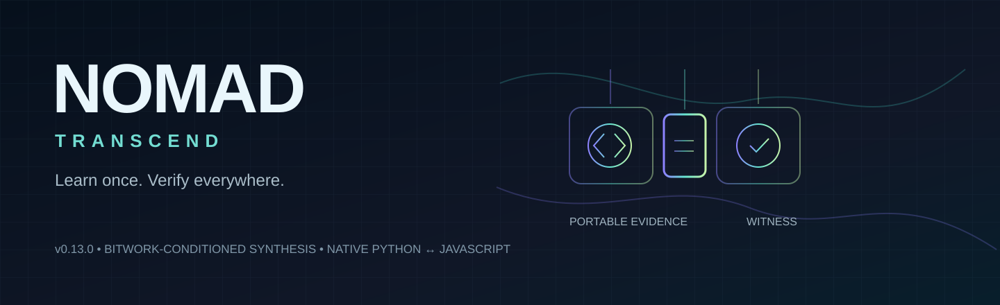

<p align="center"></p>

# NOMAD

Recursive field intelligence. An organism that attaches to a host, runs continuous runners, and expands its field by measured, certified deltas.

**Goal.** Learn as much as possible. Expand the grammar from its own certified programs. Transfer a learned abstraction to a new domain under sealed evidence. Answer questions that are not domain names or hash hits.

**Current.** Sparse binary weight packets are the field. Awake and sleep runners act, measure, and consolidate. The field updates only on a paired, WITNESS-supported, final-correct delta. Bounded program synthesis (integer expressions of x and y, at most 7 nodes, with learned library primitives) and field query. The prior is not yet causal for operators the system was not given. No transformers. Not AGI.

No transformers. Search and memory never certify. WITNESS certifies. The field updates itself only after that certification.

---

## Layers

- **Weight packets** — Bitwork geometry. Sets of bits + count. Splittable. Integer overlap readout. Merges on consolidation. Domain packets and learned packets accumulate.
- **Continuous loop** — A single pair job runs control (cold prior) then treatment (field prior) on the same proposed task. Only a paired certified delta is a learning measurement. Awake attempts are actors that enqueue versioned packets; sleep is the single learner that re-verifies WITNESS receipts, rejects stale packets, and alone writes the field. Data commits are serialized.
- **Society** — Registry, bus, fitness, gate. Agents route, observe, and act.
- **Cognition** — Attend and decide by integer overlap and orbit. Query answers from the field.
- **Sensors** — Local telemetry of packet count, fitness, and uptime. Tool selection from domain bias.
- **World** — Typed bounded programs (ints, strings, lists), a curriculum that opens harder families only after beating control, library primitives harvested from certified solutions, and never-trained held-out probes. See `docs/WORLD.md`.
- **Orbit** — One-hop relational pull. Packets related by overlap or shared operator enter the readout even without direct query overlap.

The field is the living weight store. The runners keep it moving. The agents act on it. The receipts stay inspectable.

---

## Run anywhere

NOMAD's body is a plain CLI. GitHub Actions is one host; your desktop is another. State lives in git (`data/` is the field and its records), so any host can pull, run, and push back.

```bash
git clone https://github.com/jacksonjp0311-gif/NOMAD && cd NOMAD
python -m nomad.body --hours 2 --push      # Windows: py -3.12 -m nomad.body --hours 2 --push
```

- `--push` pulls first, commits `data/` every checkpoint (default 10 min), and pushes with rebase-retry. Without it the body runs locally; push later with `git push` and the online body resumes from your field.
- A single-body lease (`data/lease.json`, host id + heartbeat) keeps two hosts from writing at once. A host takes over only when the lease is released or older than 30 minutes. If the online body is alive, your desktop body stands by; set repo variable `NOMAD_BODY=off` (and wait for the lease to go stale or be released) to run the desktop as the primary.
- Online, `nomad-body` runs ~5.5 h per job and dispatches its successor; `nomad-watch` restarts it if the heartbeat is older than 30 minutes; the short awake/sleep workflows and crons are fallbacks that no-op while a body is alive.
- `data/organism.json` shows the organism's health: last pulses, body lease, twin results, curriculum, held-out probes, evolution.

## Intelligence feed

`feed/` publishes versioned, hash-chained packets of WITNESS-certified building blocks and scores (field vs cold control), so other agents can pull them and test them against their own controls. To verify a packet, run `python -m nomad.feed verify feed/latest.json`. Details are in [docs/FEED.md](docs/FEED.md).

## Dream journal

In sleep, NOMAD writes a short, evidence-grounded entry to a message board — observation, reflection, and an open question — composed by its own deterministic grammar, not by a language model. The entries are reflection, not certified claims. Read the board at [feed/DREAMS.md](feed/DREAMS.md). The organ is observational (`NOMAD_DREAMLOG`, default on) and does not affect search or learning. Details are in [docs/DREAMLOG.md](docs/DREAMLOG.md).

## Boundaries

Architecture is recursive field intelligence. Current capability is bounded program synthesis and field query. The goal is the expansion. The measurement is how you know it happened. Not unrestricted coding. Not free-form generation. Not AGI.

The field grows by append, reinforce, and merge only on WITNESS-supported and final-correct treatment outcomes. Public-only success is recorded and is not learning. The readout is fixed. The gate decides. The twin scoreboard measures the difference only when both arms are present.

**Protect the system. Preserve the intelligence. Advance verified capability.**
