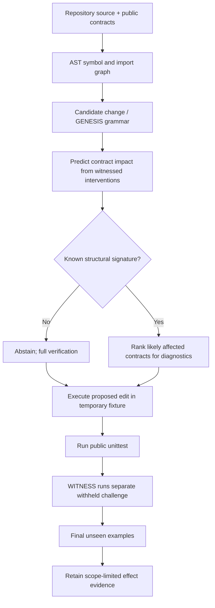

# CAUSAL ATLAS — v0.11 architecture

## Goal

Bridge NOMAD's *where* (WORLD MODEL), *what should be checked* (INQUIRY), and *what can be constructed* (GENESIS) through an impact forecast that is evaluated by WITNESS.

## Minimal data contract

`AtlasTask` contains a trusted test repository, a public input/output problem, and withheld evaluation splits. The evaluator's `changed_file` is included in fixture creation and effect-record generation; the production repair location ranking does not read it. The module must ultimately replace this benchmark structure with a genuinely blinded task API.

`SymbolGraph` builds import and symbol-to-symbol call edges from a subset of Python AST; calls that it cannot resolve are uncertain. `AtlasLearner` stores witnessed counts for discretized structural features, with Laplace smoothing `(impact+1)/(total+2)` and minimum support. `ChangeReceipt` is bound to a task, file digest, epoch and actual finite observations. It has a tamper-detecting hash, not an independently authenticated signature.

`repair_atlas_task` ranks eligible files from the public entry function's call path, invokes **unchanged** v0.10 `synthesize()` on public examples, writes a candidate expression into a temporary file, executes the actual repository, optionally runs disk-based `unittest`, then calls WITNESS and independent final evaluation. Hidden labels are not passed into synthesis or file ranking.

## Core invariants

- Only measured effects can update the impact learner.
- Unknown structural paths abstain instead of producing false safety claims.
- Predicted effects prioritize diagnostic work; they **never replace final WITNESS and test validation**.
- Source hashes, original failed prechecks and release lineage are retained.
- A transfer claim requires evaluation on independently created code, not more generated variants of the same fixture grammar.
- Runtime model is not an arbitrary-code sandbox. No model downloads, shell tool permissions or network access are needed.

## Next transition

v0.12 MNEMONIC should preserve observed impact maps and verified synthesized skills across independent restarts, then prove that transferring a previous session's evidence improves diagnosis and code construction on an *unseen, independently authored* task family relative to an identical memory-reset learner. Train and evaluation identities must be disjoint, and memory must be revoked or contested when contrary witnessed evidence arrives.
