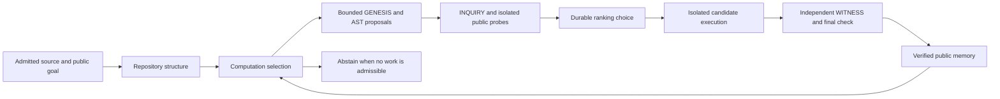

# NOMAD v0.18.0 PLATFORM architecture

The [persistent computation specification](PERSISTENT_TEMPORAL_V018.md) and
[persistent mission path](TEMPORAL_MISSION_V018.md) are the latest optional
extensions. They retain independently bound frequency, temporal and native states,
update only from public observations, and separate cached computation from
WITNESS-accepted knowledge. The frozen temporal experiment failed its joint
quality/cost objective; this path is an opt-in research capability. No platform
gate or release qualification follows from it.

The [FRONTIER function pipeline](FRONTIER_FUNCTIONS_V018.md) extends this retained
arithmetic design. The latest [adaptive mission specification](ADAPTIVE_MISSION_V018.md)
and [information-flow audit](ADAPTIVE_PIPELINE_AUDIT_V018.md) document the earlier optional effort
selection around the existing modules. All native qualification gates remain HOLD.

## Optional adaptive computation

The controller first chooses a bounded effort profile from validated public
experience, before GENESIS and AST candidate admission. Existing INQUIRY then
uses allocated public probes. A second durable choice selects the ranking
mechanism and optional MNEMONIC recall. WITNESS and the independent final
observer retain acceptance authority. Accepted public traces may inform a later
task; private values never become numerical learning targets.



Selection can use frequency, the existing temporal count ensemble or the
unchanged native BGR runtime. Expensive inference is lazy and replay work is
charged. The controller's predictor-cost approximation does not price a full
coding mission. The registered native repository experiment must establish
usefulness under complete controller-plus-worker accounting. A generated-stream
result and execution-double tests cannot establish that result.

The platform adds Windows operation, bounded execution, durable mission state and release verification around the existing intelligence system. It does not replace Bitwork with a cloud model. Native container qualification on this ROG remains **HOLD** because Docker is unavailable. A working controller or a passing mock test does not clear that gate.

## Preserved intelligence architecture

```text
Bitwork → RESONANCE → WORLD MODEL → INQUIRY → GENESIS
                                              ↓
                                          execution
                                              ↓
WITNESS → MNEMONIC → verified learning → next action
```

These components and their earlier research results remain in the repository. Their current integration differs by adapter:

| Component | v0.18 isolated mission integration | Boundary |
|---|---|---|
| Original native BGR/Bitwork | `NativeDecisionRanker` can rank public-correct proposals through the preserved runtime. | Ranking only. No eligible evidence means stable cold ordering. |
| RESONANCE | The existing encoder fuses bound observations produced by the bounded arithmetic interpreter. | These are model observations, not a host execution or native containment result. |
| WORLD MODEL | Existing AST/graph sensors and `RepositoryWorldModel.score` inspect supported modules; verified prior missions supply learned signatures. | The current public API resolves one arithmetic leaf. Competing multi-file fault localization remains HOLD. |
| INQUIRY | Existing `choose_probe` decides whether the public-suite query has positive expected utility; `_update` records the posterior after a bound baseline observation. | An empty likelihood model correctly declines discretionary probes. The current singleton menu still needs mandatory baseline validation; useful adaptive probe selection is not demonstrated. |
| GENESIS | The existing bounded synthesizer constructs expressions from public examples. Existing AST transformations provide additional proposals. | No challenge/final input enters synthesis or ranking. |
| Execution | `isolation.run_isolated` executes repository tests through Docker only. | Missing backend, preflight or cleanup proof means refusal/HOLD, never host fallback. |
| WITNESS | The original `Witness` consumes independently recomputed public and private observations. | A bounded arithmetic interpreter supplies observations without executing repository code. |
| MNEMONIC | Verified missions admit an existing `ChangeReceipt` into `EvidenceMemory`; later missions use scoped recall to rank public-correct proposals. | Memory predicts effects only. Stale, replayed or contradictory cells cannot authorize acceptance or test skipping. |
| Learning | One append-only admission can rebuild existing world, public-probe and native Bitwork models for later distinct tasks. | Replay does not refresh expiry or increase support. No automatic general skill promotion is enabled. |

The older WORLD MODEL and INQUIRY execution helpers run explicitly trusted fixtures on the host. The platform reuses their pure graph, scoring and query algorithms and never calls their host repository executors. Its new RESONANCE observation input also avoids the legacy fixture executor. The recorded world/probe posterior is diagnostic in this bounded public-interface scope; it does not yet choose between competing multi-file repairs. Component calls alone are not evidence of a localization or probe-efficiency advantage.

## Supported repository contract

`nomad.platform_mission` discovers supported top-level arithmetic modules by parsing the source and public test imports. It can resolve a public module that transparently re-exports `solve` from an arithmetic leaf. Ambiguous public APIs require an explicit `entry_module`; an optional target must agree with that public interface. The repaired leaf contains exactly one `solve(x, y)` function with a single bounded integer-arithmetic return expression. Imports, decorators, default arguments, annotations, arbitrary calls and unsupported syntax are rejected in that leaf. Other admitted modules and tests are parsed or copied without being imported or executed on the host.

The source directory must be separate from the mission directory and pass source admission. Git metadata, credential-like files, links, Windows reparse points, hardlinks, unsafe names and quota violations are refused. Use a reviewed source-only export rather than a working checkout containing `.git` or environment files. The original source directory is never edited.

Each mission supplies nonempty `public`, `challenge` and `final` partitions. An observation is `{"x": 4, "y": 2, "expected": 2}`. Input identities must be unique within each partition and disjoint across partitions. Source size, syntax size, input values and GENESIS work are bounded. Private rejection ends the mission; the controller does not feed hidden failures back into search.

The accepted claim is limited to this arithmetic contract and the observed public test run. It does not establish arbitrary Python behavior, multi-file correctness, a real upstream issue repair or safe deployment.

## Operator and Python interfaces

`python -m nomad.platform_cli` and the supported source-linked `NOMAD.cmd` launcher expose:

| Command | Effect |
|---|---|
| `doctor` | Reports runtime and Docker prerequisites without running repository code. |
| `runtime-smoke` | Runs controlled native language smoke programs, separately from untrusted isolation. |
| `trusted-demo` | Runs the preserved generated CodeWorld fixture with explicit trusted host execution. |
| `dry-run --source PATH` | Admits and hashes a source snapshot without executing it. |
| `init --source PATH --root PATH --contract FILE` | Freezes source, contract, policy, runtime identity and public planning models. No proposal has yet been synthesized. |
| `run --root PATH` | Continues the mission through isolation and independent contract checks. |
| `status --root PATH` | Checks persisted identities and reports state. |
| `recover --root PATH` | Confirms disposal of a recorded ambiguous container; does not accept a missing result. |
| `isolated-demo --root PATH` | Creates a controlled fixture and attempts the same Docker-only mission path. |

Use global `--config FILE` or `--image REVIEWED_REFERENCE` before the subcommand. An image must be reviewed, present locally and pinned by its real registry digest. The platform does not fetch images or install Docker. `init` and `isolated-demo` offer `--ranker cold|native|frequency|shuffled`, `--memory-root PATH`, `--epoch N`, `--no-adaptive`, `--execution-budget N` and `--max-eval N`. These modes do not relax verification. Epochs are explicit, monotonic evidence time, not the count of receipt replays.

The Python API is:

```python
initialize(root, source, *, goal_text, public, challenge, final,
           policy, target=None, max_eval=65000, ranker=None,
           entry_module=None, memory_root=None, capture_epoch=0,
           adaptive_enabled=True, max_executions=4)
run(root, *, interrupt_at=None)
inspect(root)
recover(root)
resolved_goal(root)
read_memory_ranker(memory_root, *, mode="native", now_epoch=0)
```

`policy` is a validated `SandboxPolicy`. The serializable ranker uses the explicit `genesis-vs-ast` action schema. Historical relational-edit observations are not interchangeable with evidence about this schema. A supplied shared memory store is checked before its accepted observations rebuild a scoped ranker. Without eligible observations, effective ranking remains cold even when the native runtime runs diagnostic predictions. `resolved_goal` reads the immutable origin plus the proposal sealed in the journal; raw `goal.json` deliberately retains `candidate: null`.

## Mission storage and transitions

```text
mission/
  goal.json       immutable goal, policy and runtime/source identities
  sealed.json     challenge/final examples; never in the worker mount
  planning_memory.json  frozen existing EvidenceMemory snapshot
  planning_ranker.json  frozen existing native-ranker snapshot
  baseline/       admitted original repository bytes
  workspace/      disposable candidate repository; committed snapshot stays here
  events.jsonl    fsynced, hash-chained transitions
  mission.lock   operating-system ownership lock
  effects/        separate fenced external-effect ledger
  learning.json  one verified observation, written only after local commit
  mnemonic/      local admission journal when no shared memory root is supplied
```

Normal progression is:

```text
PLATFORM_CREATED → PROBE_DISPATCHED → PROBE_RESULT
  → PROPOSAL_SELECTED → PATCH_PLANNED → PATCH_APPLIED
  → EXECUTION_DISPATCHED → PUBLIC_RESULT → WITNESS_RESULT
  → FINAL_RESULT → COMMITTED → LEARNED
```

A bound baseline probe precedes actual GENESIS synthesis and proposal selection. A negative candidate-public, WITNESS or final observation restores the original target and records `REVERTED`. No public-correct proposal leads to `EXHAUSTED`. Here, `COMMITTED` means accepting the mission's local candidate snapshot. It does not create a Git commit, merge, push, publish or deploy.

The controller uses the existing OS ownership lock and validates every journal transition. Original-source, candidate, source-manifest, private-evidence and runtime-source identities prevent stale artifacts from silently continuing after changes. Windows fixture materialization writes exact UTF-8 bytes so newline conversion cannot invalidate the planned hash. Windows byte-range lock contention becomes a mission HOLD.

Each dispatch gets a fresh container name persisted before launch. Identical semantic missions in separate directories do not share cleanup ownership. An execution receipt must match that name, image digest, command, source snapshot hash, file count and byte count. Exit status, timeout, cleanup and pass fields must agree. WITNESS receipts and final observations are checked again during recovery.

If the controller dies after dispatch but before recording an outcome, the next `run` refuses to guess. `recover` asks Docker to confirm disposal of only that recorded container. If confirmed, the lost result is discarded and the next run performs a new experiment. If disposal is uncertain or Docker is unavailable, recovery remains HOLD. Recorded final results and learning observations are reused rather than counted again.

This rule applies to baseline and candidate dispatches. The persisted execution budget includes both and any recovery retries. A normal successful mission uses two container experiments. Repeated recovery cannot silently create an unlimited execution budget.

Persistent learning uses the existing journal, `ChangeReceipt`, `EvidenceMemory`, world model, probe-likelihood model and native ranker. It adds no parallel intelligence framework. Admissions require a supported WITNESS receipt, a bound final observation and exact public-execution identity. Source/task/action replay does not renew its capture epoch. Planning pins the observed memory head and freezes its models; later appends are allowed, but missing or replaced history cannot be silently recreated. Cross-mission models count distinct stored tasks/sources rather than each candidate action as a new independent task. Experimental independence still requires a properly designed corpus.

Private example rows are not copied into shared learning. The store retains public contracts, source identities and integrity-bound WITNESS/final receipts. MNEMONIC effect promotion is a prediction status within its existing scope; it is not a coding skill permission or authority to skip independent final checks.

The external-effect ledger must exist and be replay-safe before a mission advances. Unknown remote effects require independent authoritative reconciliation. This adapter adds no irreversible external-action integration and makes no distributed exactly-once claim.

## Isolation and verifier trust boundaries

The worker sees a disposable source-only snapshot mounted read-only. It does not mount the original repository, mission journal, evidence partitions, host credential stores or Docker socket, and it does not inherit the host's environment secrets. Path admission rejects known credential-like files; it does not certify that arbitrary source text contains no embedded secret. The backend requests Linux containers, no network, a read-only root filesystem, a non-root user, dropped capabilities, no privilege escalation, private cgroup namespace, and CPU, memory, PID, time and output limits. Image-declared volumes are refused. Fresh Docker client configuration and a fixed local endpoint avoid inherited contexts and registry helpers.

These settings are requests to the real engine, not containment proof by themselves. `scripts/qualify_isolation_v18.py` records controlled native probes when prerequisites are available. On this host, Docker absence leaves native containment HOLD and no controlled container case has run.

Private arithmetic checks use a separate observer implementation within the trusted controller process. The observer interprets the admitted grammar; it never imports the candidate. This protects against candidate-written test reports and keeps private rows out of the worker mount. It is not authenticated remote WITNESS, a separately protected verifier service, or protection from an attacker who can rewrite the trusted host controller and all evidence. Local hashes are integrity checks, not signatures.

## Verification and remaining integration

`tests/test_platform_mission_v18.py` covers interruption points, ambiguous dispatch recovery, receipt substitution, stale runtime/evidence, private contradictions, duplicate observations, source preservation, Windows ownership, links and portable snapshot ordering. `tests/test_pipeline_qualification_v18.py` adds real parser/learner integration with the host repository executors explicitly forbidden, deferred proposal ordering, distinct-task memory, replay/expiry, lost-history faults and bounded recovery. Docker receipt doubles test controller contracts only. Native process tests and native containment experiments are reported separately.

The inherited Catalogue false-positive remains a permanent regression: incomplete public test success must not authorize a namespace-breaking repair. Platform work does not revise the negative v0.14 transfer result or turn a bounded native Bitwork benchmark into proof of general coding improvement.

The next work is in [NEXT_ITERATION.md]: native containment and interrupted isolated missions, independently validated external repairs, and useful WORLD MODEL/INQUIRY decisions beyond the current single-leaf interface. Cross-mission effect-memory integration is implemented and contract-tested; actual isolated qualification and automatic general skill admission remain HOLD.
# FRONTIER qualification addendum, v0.18.0

The current development snapshot adds a bounded JSON function adapter alongside
the arithmetic path documented below. See [function pipeline](FRONTIER_FUNCTIONS_V018.md)
for import-graph analysis, public diagnostic probes, posterior-guided search,
multi-file proposals and the `F_*` durable transitions. The existing native BGR,
GENESIS, RESONANCE, WORLD MODEL, INQUIRY, WITNESS and MNEMONIC modules are reused.
No cloud model or alternative agent framework is introduced.

The parent owns private expected values and compares complete, hash-bound JSON
observations from a disposable Docker execution. Source admission is a restricted
observation-language check, not an OS sandbox. Every unfamiliar program still
requires the verified container boundary. Recovery validates source, runtime,
sealed partitions, patch transactions, dispatches and learning provenance before
continuing. An uncertain dispatch requires explicit observed cleanup.

[Candidate self-revision](SELF_REVISION_FRONTIER_V018.md) is a read-only review
of a separate candidate and original. It does not install a modification.
[Native evidence](NATIVE_FRONTIER_V018.md) and the [current report](FRONTIER_REPORT_V018.md)
keep all four gates HOLD. Synthetic Bitwork mechanism results do not substitute
for independently accepted real-repository missions or cross-task transfer.


## Operational corrections: MAKE IT WORK

The CLI function path now selects conventional temporal learning by default;
`--mechanism native` uses the unchanged original native BGR. The operating
profile disables change detection and delayed-credit selection and retains
selective warm states. Explicit research configurations remain distinct and
frozen research code is not rewritten to adopt these engineering defaults.

A fixed mechanism is bound into the immutable mission allocation. Both runtime
and replay enforce that choice, its current commitment and a reserved independent
verification budget. Cold reconstruction uses the same fixed mechanism; a warm
cache with a different operating choice is not silently reused. Within a
commitment, the candidate order is retained and the live learned state continues,
without a redundant full control snapshot after each failed attempt. Every
public outcome still receives its durable update; restart and corruption checks
retain their authority. Independent memory validation replay remains necessary
and is not claimed to be free.

`inspect-source` performs source admission without an engine or source import.
`repair` reuses the existing initializer/controller/worker/WITNESS pipeline after
validating native containment and live engine readiness. `review`, `accept` and
`reject` revalidate terminal evidence and export a unified diff with hashes and
receipts. They do not overwrite the original repository or confer deployment
permission. The new workflow adds no frontend, service or execution backend.
